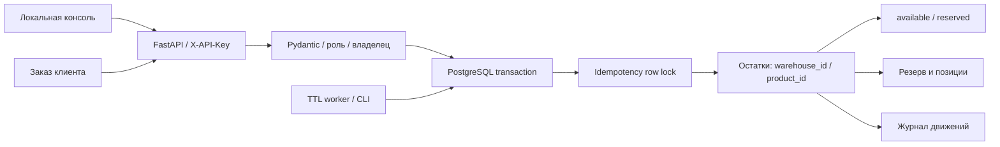

# Устройство «Остатка»

Небольшой синхронный монолит: HTTP/консоль, доменные транзакции и SQL-миграции находятся рядом. PostgreSQL — единственный источник остатков и сроков. SQLite, in-memory stock и фиктивных интеграций нет.

## Модель остатка

`on_hand = available + reserved`. Все количества — целые единицы; дробные массы и денежные суммы здесь не моделируются. В PostgreSQL `CHECK` запрещает отрицательные `available`/`reserved`; верхний предел каждого — 10¹². Приход и позиция ограничены 10⁹ единицами.

| Операция | available | reserved | Физический остаток |
|---|---|---|---|
| Приход q | +q | 0 | +q |
| Резерв q | −q | +q | Без изменения |
| Подтверждение q | 0 | −q | −q |
| Отмена / истечение q | +q | −q | Без изменения |

Операции сохраняют движение, документ и остатки в одной транзакции. Удаления товаров, складов, резервов и истории через API нет. Внешние платежи/доставка не эмулируются: confirm означает списание под отгрузку в рамках этого API.

## Конкуренция и срок жизни

При bulk reserve сначала проверяются ссылки, затем все затрагиваемые balances блокируются `FOR UPDATE` в порядке `(warehouse_id, product_id)`. Проверка доступности происходит после получения блокировок; все позиции изменяются целиком либо транзакция откатывается. Обратный порядок позиций во входном JSON не меняет порядок locks.

Confirm/cancel сначала блокируют строку резерва, затем balances в том же порядке. После ожидания stock locks confirm снова сравнивает `clock_timestamp()` PostgreSQL с `expires_at`. Истёкший резерв освобождается и остаётся в истории, confirm возвращает 409. Точка решения о TTL находится после получения locks; это не обещание real-time commit к конкретной миллисекунде.

Sweeper выбирает одну истёкшую active-строку с `FOR UPDATE SKIP LOCKED`, освобождает все её позиции и фиксирует результат. Несколько sweepers могут работать одновременно. В приложении проход запускается каждые 5 секунд; есть отдельный CLI и admin endpoint. При остановленном приложении запускайте CLI worker. До освобождения просроченный резерв может временно уменьшать доступный остаток, но подтверждать его нельзя.

Последовательный порядок locks — осознанное следование [рекомендации PostgreSQL по предотвращению deadlocks](https://www.postgresql.org/docs/18/explicit-locking.html#LOCKING-DEADLOCKS). При lock/statement timeout клиент получает 503 и может повторить запрос с прежним ключом. Автоматические неограниченные retries отсутствуют.

## Идемпотентность и права

Ключ хранится в уникальной строке `(client_id, endpoint, key)`. Сначала выполняется INSERT ON CONFLICT, затем row lock; конкурентный повтор ждёт завершения первого запроса. В той же транзакции сохраняются canonical fingerprint и JSON-ответ со статусом. Порядок JSON-полей незначим, значения по умолчанию нормализуются; порядок элементов массива сохраняется. Для конкретного пути confirm/cancel используется отдельная область ключей.

Коммит позволяет повторить прежний результат после потери HTTP-ответа. Успешный reserve replay вернёт исходный снимок ответа, даже если резерв позднее закрыт; актуальный статус нужно читать GET. Конфликт содержимого под committed key даёт 409. Ошибка валидации/остатков откатывает idempotency row; исключение — confirm, обнаруживший expiry: освобождение и ответ 409 фиксируются вместе. Retention ключей пока отсутствует.

Случайный `ost_...` ключ содержит 32 bytes entropy; БД хранит SHA-256. Это API token, а не пользовательский пароль, поэтому медленный password hash не нужен. Роли reader/operator/admin проверяются на каждом endpoint. Резервы ограничены клиентом, admin видит все; каталог и движения общие для доверенной команды, полноценной tenant-изоляции здесь нет. Совместный client_id означает намеренно общий доступ и idempotency namespace.

Bootstrap, выпуск и отзыв ключей используют одну advisory transaction lock, защищая последнего активного admin. Секрет возвращается только при выпуске; list и /me не содержат hash или secret. В логах нет заголовков/тел запросов или DATABASE_URL.

## Миграции и развёртывание

SQL-файлы применяются в одном transaction под advisory lock. В schema_migrations записываются имя и SHA-256; изменение уже применённого файла останавливает миграцию. Startup и /health проверяют совпадение схемы. Изменения схемы добавляются новым файлом, rollback данных требует проверенной резервной копии.

На операцию открывается psycopg connection, общая Python-память не синхронизирует остатки. Это простая локальная схема с ценой установления соединений. Внешнего pooler, метрик нагрузки и горизонтального autoscaling нет. Pagination использует стабильный порядок и отдельную read-only repeatable-read транзакцию для total/items.

Dockerfile запускает API как UID/GID 10001 и имеет healthcheck. Compose использует PostgreSQL 18, отдельную non-superuser app-role и volume на `/var/lib/postgresql`, как предусмотрено [официальным образом PostgreSQL 18](https://github.com/docker-library/docs/tree/master/postgres#pgdata). Docker-сборка локально не выполнялась.

## Вопросы для разбора на интервью

1. **Почему недостаточно проверить available обычным SELECT, а затем сделать UPDATE?** Два запроса могут одновременно увидеть один остаток. Row lock заставляет второй дождаться первого и проверить актуальное значение; DB CHECK служит дополнительной границей. Обсудите альтернативу условного UPDATE и сложность нескольких позиций.
2. **Что произойдёт, если БД закоммитила confirm, а HTTP-ответ потерялся, и как это отличается от expiry race?** Повтор с тем же client/endpoint/key получает сохранённый ответ без повторного списания. В expiry race строка резерва сериализует переход; проверка времени после stock locks не допускает подтверждение уже истёкшего резерва.
